---
## Author
author:
  name: Верниковская Екатерина Андреевна
  degrees: DSc
  orcid: 0000-0002-0877-7063
  email: kulyabov-ds@rudn.ru
  affiliation:
    - name: Российский университет дружбы народов
      country: Российская Федерация
      postal-code: 117198
      city: Москва
      address: ул. Миклухо-Маклая, д. 6

## Title
title: "Отчёт по лабораторной работе №5"
subtitle: "Дисциплина: Моделирование сетей передачи данных"
license: "CC BY"

nocite: |
  @*
---

# Цель работы

Целью данной работы является получение навыков проведения интерактивных экспериментов в среде Mininet по исследованию параметров сети, связанных с потерей, дублированием, изменением порядка и повреждением пакетов при передаче данных. Эти параметры влияют на производительность протоколов и сетей

# Задание

1. Задать простейшую топологию, состоящую из двух хостов и коммутатора с назначенной по умолчанию mininet сетью 10.0.0.0/8
2. Провести интерактивные эксперименты по исследованию параметров сети, связанных с потерей, дублированием, изменением порядка и повреждением пакетов при передаче данных
3. Реализовать воспроизводимый эксперимент по добавлению правила отбрасывания пакетов в эмулируемой глобальной сети. На экран вывести сводную информацию о потерянных пакетах
4. Самостоятельно реализовать воспроизводимые эксперименты по исследованию параметров сети, связанных с потерей, изменением порядка и повреждением пакетов при передаче данных. На экран вывести сводную
информацию о потерянных пакетах

# Выполнение лабораторной работы

## Запуск лабораторной топологии

Запустили виртуальную среду с mininet и после из основной ОС подключились к виртуальной машине ``` ssh -Y mininet@192.168.56.105``` ([рис. @fig-001]):

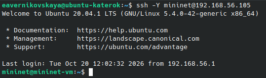{#fig-001 width=70%}

Исправили права запуска X-соединения. Скопировали значение куки (MIT magic cookie) своего пользователя mininet в файл для пользователя root ([рис. @fig-002]):

```
mininet@mininet-vm:~$ xauth list $DISPLAY
mininet@mininet-vm:~$ sudo -i
root@mininet-vm:~# xauth add mininet-vm/unix:10 MIT-MAGIC-COOKIE-1 "значение-куки"
root@mininet-vm:~# logout
```

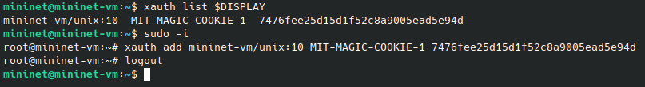{#fig-002 width=70%}

После выполнения этих действий графические приложения будут запускаться под пользователем mininet

Задали простейшую топологию, состоящую из двух хостов и коммутатора с назначенной по умолчанию mininet сетью 10.0.0.0/8: ```sudo mn --topo=single,2 -x```. После введения этой команды запустились терминалы двух хостов, коммутатора и контроллера. Терминалы коммутатора и контроллера закрыли ([рис. @fig-003])

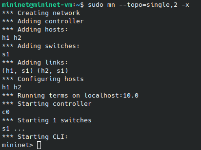{#fig-003 width=70%}

На хостах h1 и h2 ввели команду ```ifconfig```, чтобы отобразить информацию, относящуюся к их сетевым интерфейсам и назначенным им IP-адресам. В дальнейшем при работе с NETEM и командой tc будут использоваться интерфейсы h1-eth0 и h2-eth0 ([рис. @fig-004])

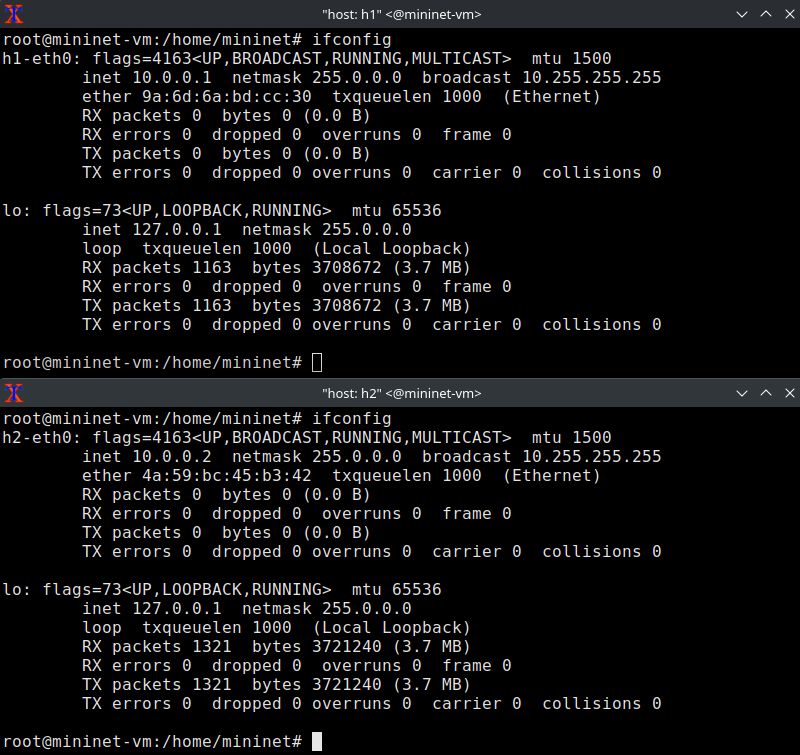{#fig-004 width=70%}

Проверили подключение между хостами h1 и h2 с помощью команды ```ping``` с параметром ```-c 6``` ([рис. @fig-005])

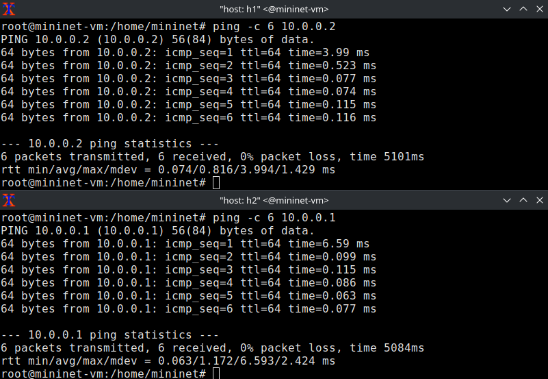{#fig-005 width=70%}

**Данные с хоста h1:**

- Минимальное время (min): 0.074 мс
- Среднее время (avg): 0.816 мс
- Максимальное время (max): 3.994 мс
- Стандартное отклонение (mdev): 1.429 мс

**Данные с хоста h2:**

- Минимальное время (min): 0.063 мс
- Среднее время (avg): 1.172 мс
- Максимальное время (max): 6.593 мс
- Стандартное отклонение (mdev): 2.424 мс

##  Интерактивные эксперименты

### Добавление потери пакетов на интерфейс, подключённый к эмулируемой глобальной сети

Пакеты могут быть потеряны в процессе передачи из-за таких факторов, как битовые ошибки и перегрузка сети. Скорость потери данных часто измеряется как процентная доля потерянных пакетов по отношению к количеству отправленных пакето

На хосте h1 добавили 10% потерь пакетов к интерфейсу h1-eth0: ```sudo tc qdisc add dev h1-eth0 root netem loss 10%```  ([рис. @fig-006])

Здесь:

- ```sudo```: выполнить команду с более высокими привилегиями;
- ```tc```: вызвать управление трафиком Linux;
- ```qdisc```: изменить дисциплину очередей сетевого планировщика;
- ```add```: создать новое правило;
- ```dev h1-eth0```: указать интерфейс, на котором будет применяться правило;
- ```netem```: использовать эмулятор сети;
- ```loss 10%```: 10% потерь пакетов.

После проверили, что соединение от хоста h1 к хосту h2 имеются потери пакетов используя команду ```ping``` с параметром ```-c 100``` с хоста h1.  ([рис. @fig-006])

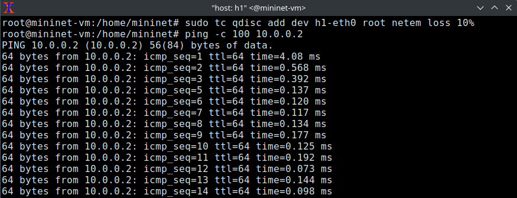{#fig-006 width=70%}

Некоторые номера последовательности отсутствуют из-за потери пакетов. В сводном отчёте ping сообщает о проценте потерянных пакетов после завершения передачи. Передано 100 пакетов, пришло 94 пакетов, 6% потеря пакетов ([рис. @fig-007])

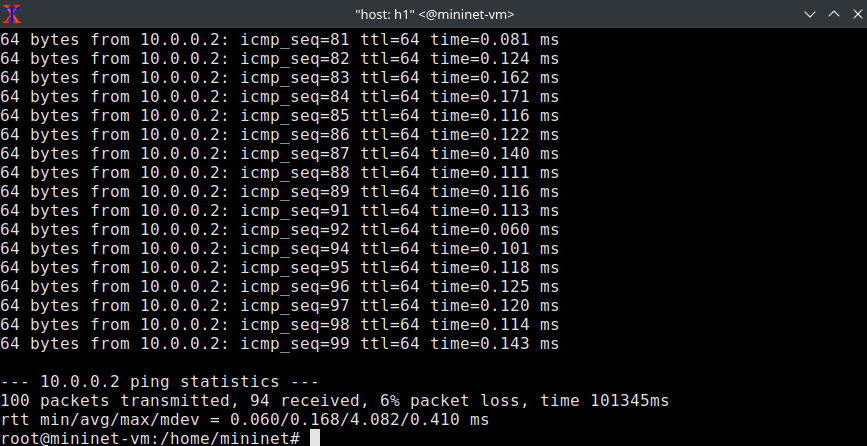{#fig-007 width=70%}

Для эмуляции глобальной сети с потерей пакетов в обоих направлениях к соответствующему интерфейсу на хосте h2 также добавили 10% потерь пакетов: ```sudo tc qdisc add dev h2-eth0 root netem loss 10%``` ([рис. @fig-008])

Проверили, что соединение между хостом h1 и хостом h2 имеет больший процент потерянных данных (10% от хоста h1 к хосту h2 и 10% от хоста h2 к хосту h1), повторив команду ```ping``` с параметром ```-c 100``` на терминале хоста h1 ([рис. @fig-008])

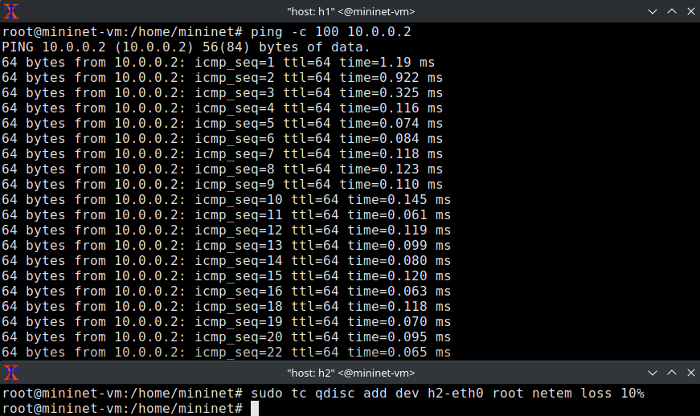{#fig-008 width=70%}

Передано 100 пакетов, пришло 80 пакетов, 20% потеря пакетов после завершения передачи, номера потерянных пакетов (значения ```icmp_seq```) 17, 21, ..., 98 ([рис. @fig-009])

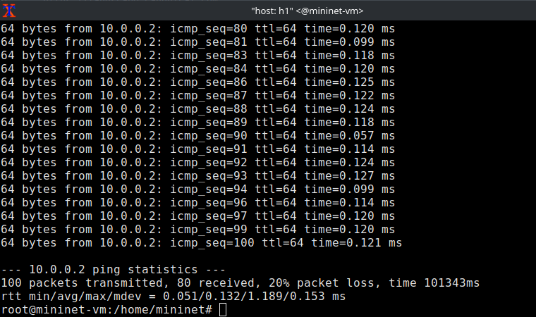{#fig-009 width=70%}

Восстановили конфигурацию по умолчанию, удалив все правила, применённые к сетевому планировщику соответствующего интерфейса. Для отправителя h1: ```sudo tc qdisc del dev h1-eth0 root netem```. И для получателя ```h2 sudo tc qdisc del dev h2-eth0 root netem``` ([рис. @fig-010])

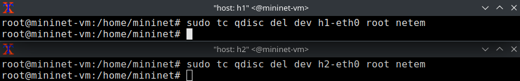{#fig-010 width=70%}

Убедились, что соединение от хоста h1 к хосту h2 не имеет явной потери пакетов, запустив команду ```ping``` с терминала хоста h1 и затем нажав ```Ctrl + c``` , чтобы остановить тест ([рис. @fig-011])

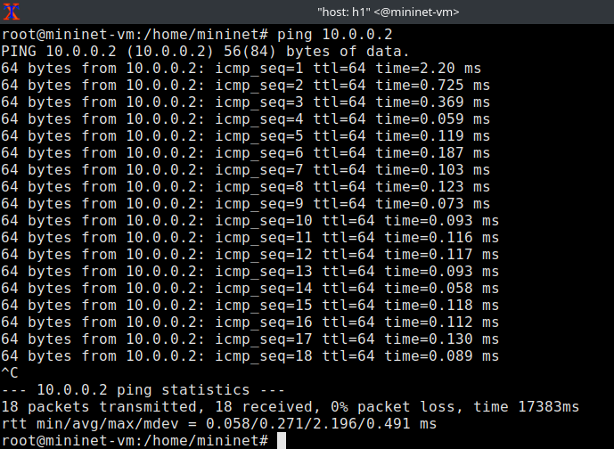{#fig-011 width=70%}

### Добавление значения корреляции для потери пакетов в эмулируемой глобальной сети

Добавили на интерфейсе узла h1 коэффициент потери пакетов 50% (такой высокий уровень потери пакетов маловероятен), и каждая последующая вероятность зависит на 50% от последней: ```sudo tc qdisc add dev h1-eth0 root netem loss 50% 50%``` ([рис. @fig-012])

Проверили, что на соединении от хоста h1 к хосту h2 имеются потери пакетов, используя команду ```ping``` с параметром ```-c 50``` с хоста h1 ([рис. @fig-012])

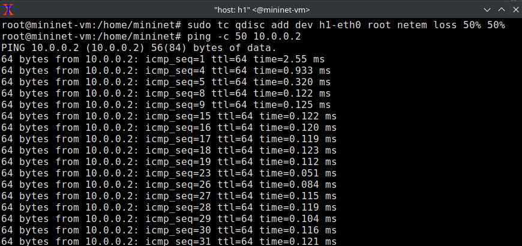{#fig-012 width=70%}

Передано 50 пакетов, пришло 31 пакетов, 38% потеря пакетов после завершения передачи, номера потерянных пакетов (значения ```icmp_seq```) 2, 3, ..., 46 ([рис. @fig-013])

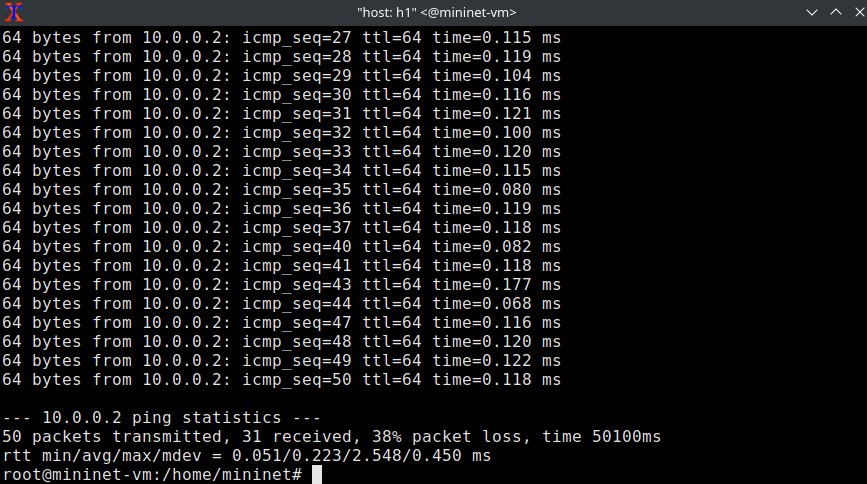{#fig-013 width=70%}

Восстановили для узла h1 конфигурацию по умолчанию, удалив все правила, применённые к сетевому планировщику соответствующего интерфейса: ```sudo tc qdisc del dev h1-eth0 root netem``` ([рис. @fig-014])

{#fig-014 width=70%}

### Добавление повреждения пакетов в эмулируемой глобальной сети

Добавили на интерфейсе узла h1 0,01% повреждения пакетов: ```sudo tc qdisc add dev h1-eth0 root netem corrupt 0.01%``` ([рис. @fig-015])

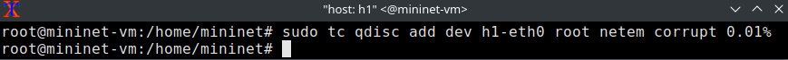{#fig-015 width=70%}

Проверили конфигурацию с помощью инструмента iPerf3 для проверки повторных передач. Для этого:

- запустили iPerf3 в режиме сервера в терминале хоста h2 ([рис. @fig-016]): ```iperf3 -s```
- запустили iPerf3 в клиентском режиме в терминале хоста h1 ([рис. @fig-016]): ```iperf3 -c 10.0.0.2```
- для остановки сервера iPerf3 нажали ```Ctrl + c``` в терминале хоста h2

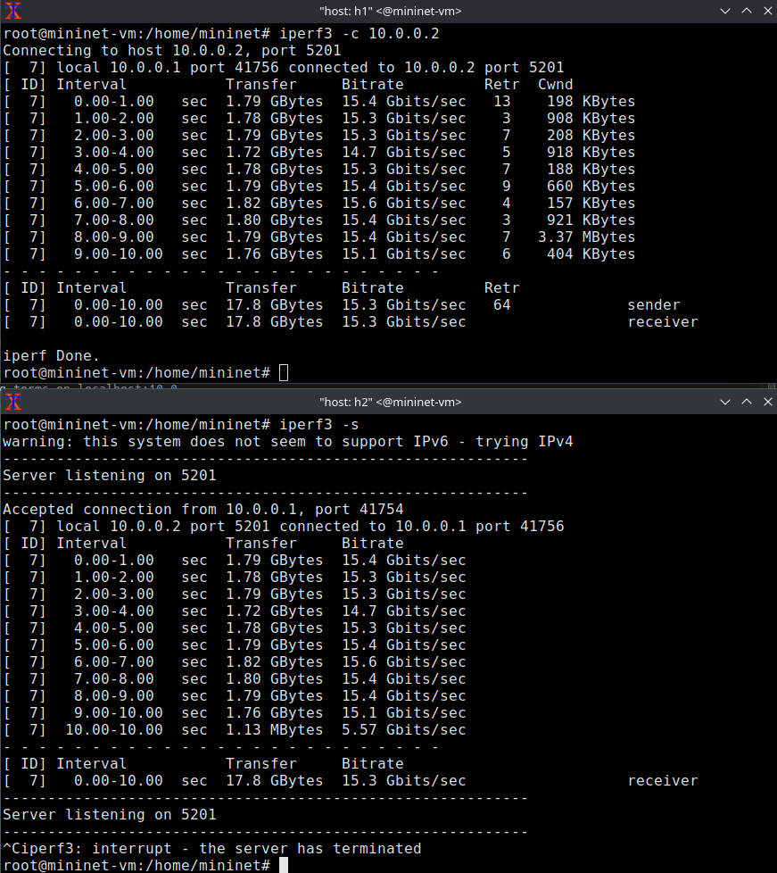{#fig-016 width=70%}

**Общее количество повторно переданных пакетов:** 64

Восстановили для узла h1 конфигурацию по умолчанию, удалив все правила, применённые к сетевому планировщику соответствующего интерфейса: ```sudo tc qdisc del dev h1-eth0 root netem``` ([рис. @fig-017])

{#fig-017 width=70%}

### Добавление переупорядочивания пакетов в интерфейс подключения к эмулируемой глобальной сети

Добавили на интерфейсе узла h1 следующее правило: ```sudo tc qdisc add dev h1-eth0 root netem delay 10ms reorder 25% 50%``` ([рис. @fig-018]). Здесь 25% пакетов (со значением корреляции 50%) будут отправлены немедленно, а остальные 75% будут задержаны на 10 мс

Проверили, что на соединении от хоста h1 к хосту h2 имеются потери пакетов, используя команду ```ping``` с параметром ```-c 20``` с хоста h1. Убедились, что часть пакетов не имеют задержки, а последующие несколько пакетов имеют задержку около 10 миллисекунд ([рис. @fig-018])

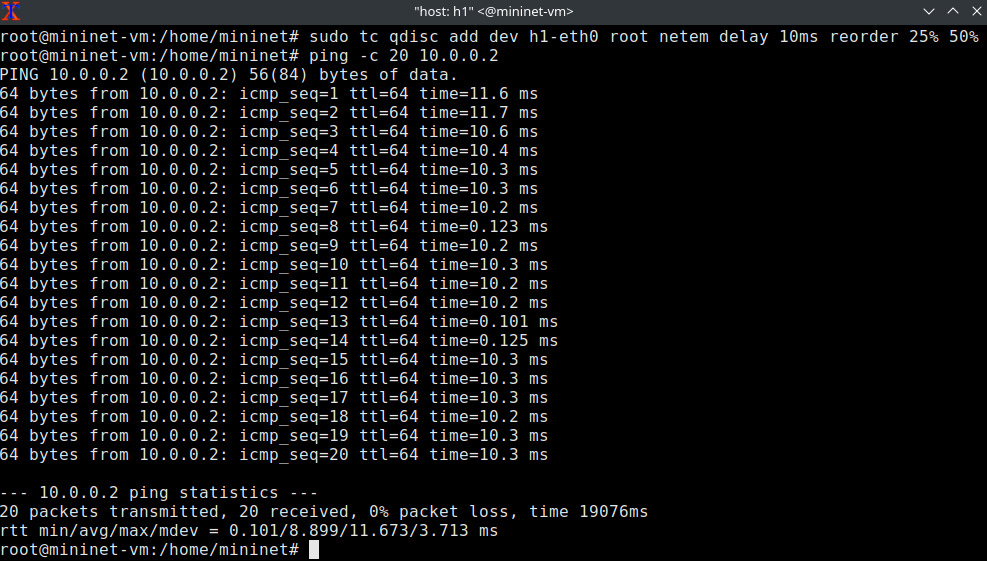{#fig-018 width=70%}

Передано 20 пакетов, пришло 20 пакетов, 0% потеря пакетов после завершения передачи

Восстановили для узла h1 конфигурацию по умолчанию, удалив все правила, применённые к сетевому планировщику соответствующего интерфейса: ```sudo tc qdisc del dev h1-eth0 root netem``` ([рис. @fig-019])

{#fig-019 width=70%}

### Добавление дублирования пакетов в интерфейс подключения к эмулируемой глобальной сети

Для интерфейса узла h1 задали правило c дублированием 50% пакетов (т.е. 50% пакетов должны быть получены дважды): ```sudo tc qdisc add dev h1-eth0 root netem duplicate 50%``` ([рис. @fig-020])

Проверили, что на соединении от хоста h1 к хосту h2 имеются дублированные пакеты, используя команду ```ping``` с параметром ```-c 20``` с хоста h1. Дубликаты пакетов помечаются как DUP!. Измеренная скорость дублирования пакетов будет приближаться к настроенной скорости по мере выполнения большего
количества попыток ([рис. @fig-020])

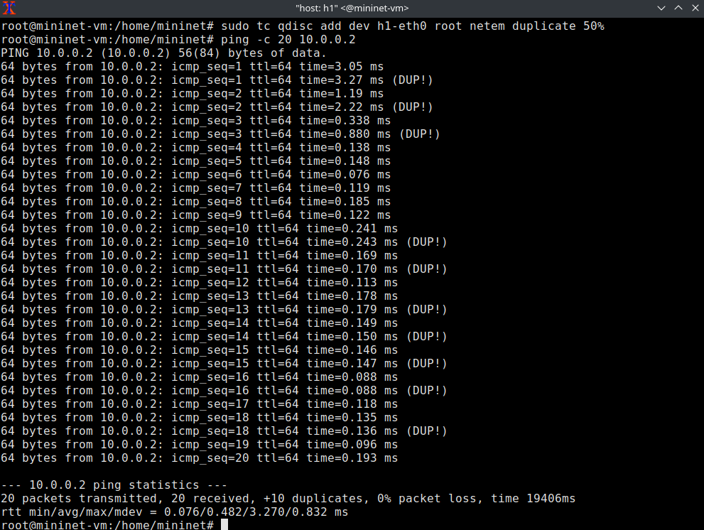{#fig-020 width=70%}

Передано 20 пакетов, пришло 20 пакетов, +10 пакетов дубликатов, 0% потеря пакетов после завершения передачи

Восстановили для узла h1 конфигурацию по умолчанию, удалив все правила, применённые к сетевому планировщику соответствующего интерфейса: ```sudo tc qdisc del dev h1-eth0 root netem``` ([рис. @fig-021])

{#fig-021 width=70%}

## Воспроизведение экспериментов

### Предварительная подготовка

Для каждого воспроизводимого эксперимента ```expname``` создали свой каталог, в котором будут размещаться файлы эксперимента ```mkdir -p ~/work/lab_netem_ii/expname```. Здесь ```expname``` может принимать значения ```simple-drop```, ```change-delay```, ```correlation-drop``` и т.п. Также для каждого случая создали скрипт для проведения эксперимента ```lab_netem_ii.py``` ([рис. @fig-022])

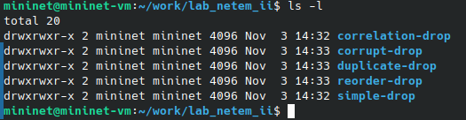{#fig-022 width=70%}

### Добавление потери пакетов на интерфейс, подключённый к эмулируемой глобальной сети

С помощью API Mininet воспроизвели эксперимент по добавлению потери пакетов для интерфейса хоста, подключающегося к эмулируемой глобальной сети

В виртуальной среде mininet перешли в каталог ```simple-drop```: ```cd ~/work/lab_netem_ii/simple-drop``` ([рис. @fig-023])

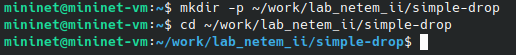{#fig-023 width=70%}

Создали скрипт для эксперимента ```lab_netem_ii.py``` ([рис. @fig-024]): 

```python
#!/usr/bin/env python

"""
Simple experiment.
Output: ping.dat
"""

from mininet.net import Mininet
from mininet.node import Controller
from mininet.cli import CLI
from mininet.log import setLogLevel, info
import time

def emptyNet():

    "Create an empty network and add nodes to it."

    net = Mininet( controller=Controller, waitConnected=True )

    info( '*** Adding controller\n' )
    net.addController( 'c0' )

    info( '*** Adding hosts\n' )
    h1 = net.addHost( 'h1', ip='10.0.0.1' )
    h2 = net.addHost( 'h2', ip='10.0.0.2' )

    info( '*** Adding switch\n' )
    s1 = net.addSwitch( 's1' )

    info( '*** Creating links\n' )
    net.addLink( h1, s1 )
    net.addLink( h2, s1 )

    info( '*** Starting network\n')
    net.start()

    info( '*** Set delay\n')
    h1.cmdPrint( 'tc qdisc add dev h1-eth0 root netem loss 10%' )
    h2.cmdPrint( 'tc qdisc add dev h2-eth0 root netem loss 10%' )

    time.sleep(10) # Wait 10 seconds

    info( '*** Ping\n')
    h1.cmdPrint( 'ping -c 100', h2.IP(), '| grep "time=" | awk \'{print $5, $7}\' | sed -e \'s/time=//g\' -e \'s/icmp_seq=//g\' > ping.d>

    info( '*** Stopping network' )
    net.stop()

if __name__ == '__main__':
    setLogLevel( 'info' )
    emptyNet()
```

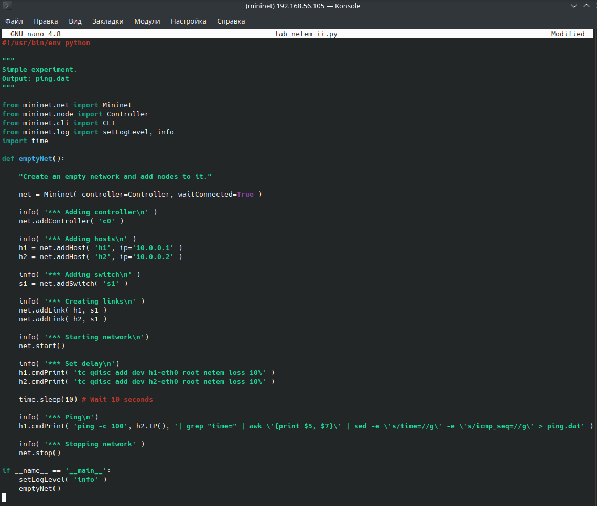{#fig-024 width=70%}

Скрипт ```lab_netem_ii.py``` создаёт в Mininet топологию из двух хостов (```h1``` - 10.0.0.1, ```h2``` - 10.0.0.2) и коммутатора s1, запускает сеть с контроллером c0 и добавляет на интерфейсы ```h1-eth0``` и ```h2-eth0``` правило 10 % потери пакетов через ```tc qdisc ... netem loss 10%``` (строки 38-39). После паузы 10 с он отправляет с h1 команду ```ping -c 100``` к h2 и через конвейер ```grep "time=" | awk | sed``` извлекает из вывода значения ```icmp_seq``` и ```time```, сохраняя их в файл ```ping.dat```. В конце скрипт останавливает сеть вызовом ```net.stop()``` 

Скорректировали скрипт так, чтобы в отдельный файл выводилась информация о потерях пакетов ([рис. @fig-025]): 

```python
info( '*** Ping\n' )
    h1.cmdPrint('ping -c 100', h2.IP(), "| grep 'packet loss' | awk '{print \"Transmitted:\", $1, \"packets\\n\"" "\"Received:\", $4, \"packets\\n\"" "\"Loss:\", $6, \"\\n\"" "\"time:\", $10}' > ping.dat")
```

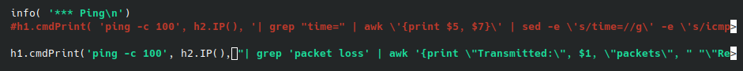{#fig-025 width=70%}

Создали ```Makefile``` для управления процессом проведения эксперимента ([рис. @fig-026]): 

```bash
all: ping.dat ping.png

ping.dat:
        sudo python lab_netem_ii.py
        sudo chown mininet:mininet ping.dat

clean:
        -rm -f *.dat
```

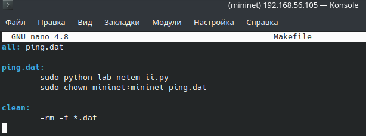{#fig-026 width=70%}

Далее выполнили эксперимент: ```make``` ([рис. @fig-027])

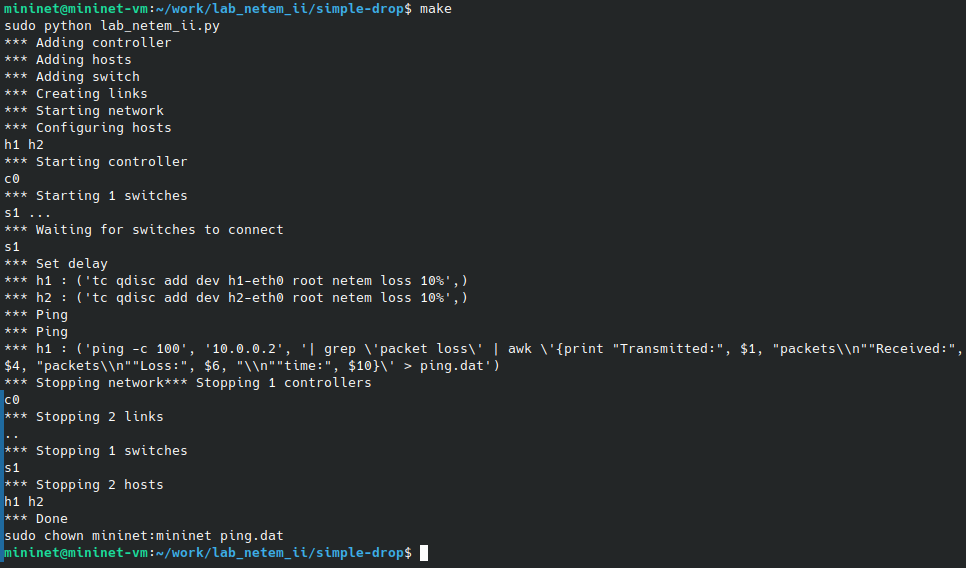{#fig-027 width=70%}

Вывели информацию о потерях пакетов из файла ```ping.dat``` ([рис. @fig-028])

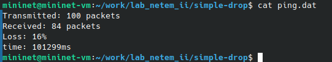{#fig-028 width=70%}  

Очистили каталог от результатов проведения экспериментов: ```make clean``` ([рис. @fig-029])

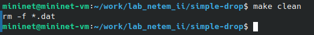{#fig-029 width=70%} 

### Задание для самостоятельной работы

С помощью API Mininet воспроизвели эксперимент по добавлению значения корреляции для потери пакетов
в эмулируемой глобальной сети

В виртуальной среде mininet перешли в каталог ```correlation-drop``` и отредактировали скрипт для эксперимента ```lab_netem_ii.py``` ([рис. @fig-030]):

```python
h1.cmdPrint( 'tc qdisc add dev h1-eth0 root netem loss 50% 50%' )
```

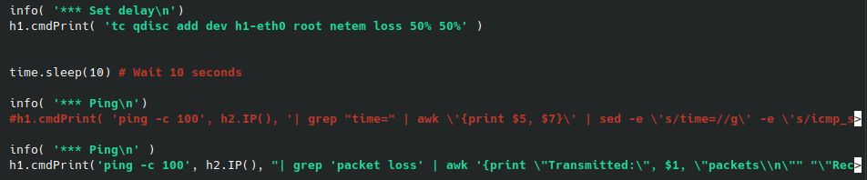{#fig-030 width=70%}

Далее выполнили эксперимент: ```make``` ([рис. @fig-031])

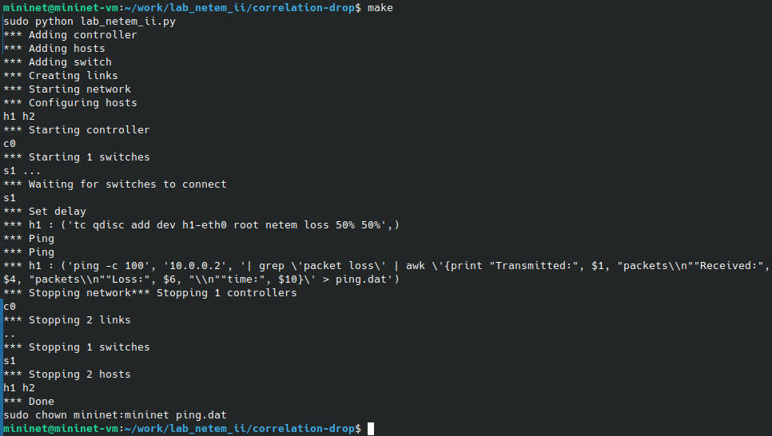{#fig-031 width=70%}

Вывели информацию о потерях пакетов из файла ```ping.dat``` ([рис. @fig-032])

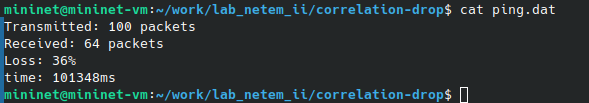{#fig-032 width=70%}  

Очистили каталог от результатов проведения экспериментов: ```make clean``` ([рис. @fig-033])

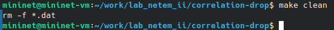{#fig-033 width=70%} 

С помощью API Mininet воспроизвели эксперимент по добавлению повреждения пакетов  в эмулируемой глобальной сети

В виртуальной среде mininet перешли в каталог ```corrupt-drop``` и отредактировали скрипт для эксперимента ```lab_netem_ii.py``` ([рис. @fig-034]):

```python
h1.cmdPrint( 'tc qdisc add dev h1-eth0 root netem corrupt 0.01%' )
```

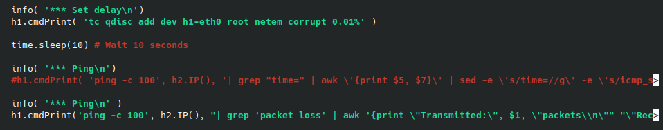{#fig-034 width=70%}

Далее выполнили эксперимент: ```make``` ([рис. @fig-035])

{#fig-035 width=70%}

Вывели информацию о потерях пакетов из файла ```ping.dat``` ([рис. @fig-036])

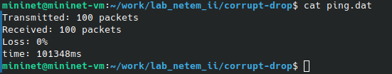{#fig-036 width=70%}  

Очистили каталог от результатов проведения экспериментов: ```make clean``` ([рис. @fig-037])

{#fig-037 width=70%} 

С помощью API Mininet воспроизвели эксперимент по добавлению переупорядочивания пакетов в интерфейс
подключения к эмулируемой глобальной сети

В виртуальной среде mininet перешли в каталог ```reorder-drop``` и отредактировали скрипт для эксперимента ```lab_netem_ii.py``` ([рис. @fig-038]):

```python
h1.cmdPrint( 'tc qdisc add dev h1-eth0 root netem delay 10ms reorder 25% 50%' )
```

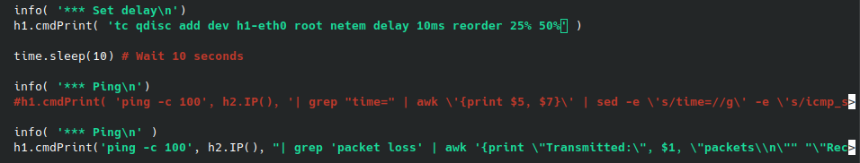{#fig-038 width=70%}

Далее выполнили эксперимент: ```make``` ([рис. @fig-039])

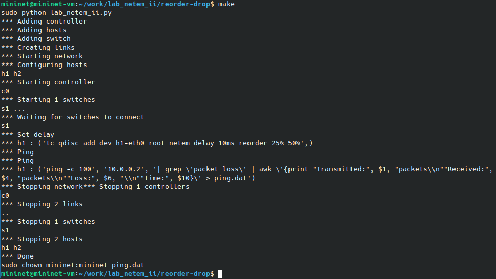{#fig-039 width=70%}

Вывели информацию о потерях пакетов из файла ```ping.dat``` ([рис. @fig-040])

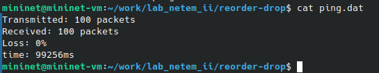{#fig-040 width=70%}  

Очистили каталог от результатов проведения экспериментов: ```make clean``` ([рис. @fig-041])

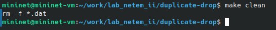{#fig-041 width=70%} 

С помощью API Mininet воспроизвели эксперимент по добавлению дублирования пакетов в интерфейс подключения к эмулируемой глобальной сети

В виртуальной среде mininet перешли в каталог ```duplicate-drop``` и отредактировали скрипт для эксперимента ```lab_netem_ii.py``` ([рис. @fig-042]):

```python
h1.cmdPrint( 'tc qdisc add dev h1-eth0 root netem duplicate 50%' )
```

и

```python
h1.cmdPrint('ping -c 100', h2.IP(), "| grep 'packet loss' | awk '{print \"Transmitted:\", $1, \"packets\\n\"" "\"Received:\", $4, \"packets\\n\"" "\"Dublicates:\", $6, \"packets\\n\"" "\"Loss:\", $8, \"\\n\"" "\"time:\", $12}' > ping.dat")
```

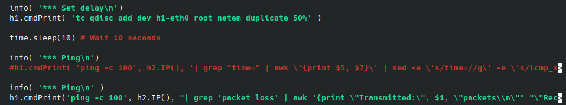{#fig-042 width=70%}

Далее выполнили эксперимент: ```make``` ([рис. @fig-043])

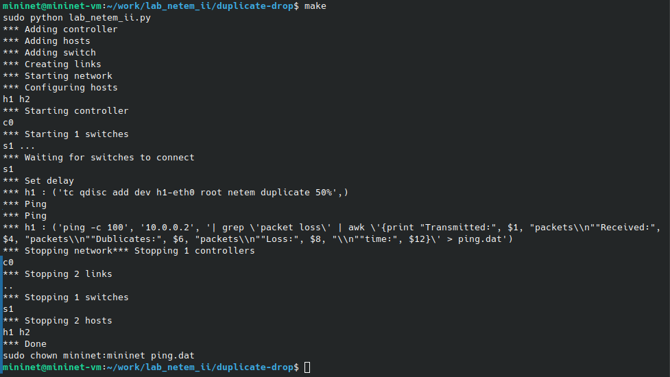{#fig-043 width=70%}

Вывели информацию о потерях пакетов из файла ```ping.dat``` ([рис. @fig-044])

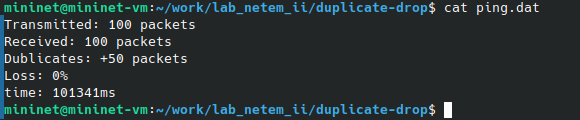{#fig-044 width=70%}  

Очистили каталог от результатов проведения экспериментов: ```make clean``` ([рис. @fig-045])

{#fig-045 width=70%}

# Выводы

В ходе выполнения лабораторной работы №5 мы получили навыки проведения интерактивных экспериментов в среде Mininet по исследованию параметров сети, связанных с потерей, дублированием, изменением порядка и повреждением пакетов при передаче данных. Эти параметры влияют на производительность протоколов и сетей

# Список литературы{.unnumbered}

::: {#refs}
:::
