---
## Author
author:
  name: Верниковская Екатерина Андреевна
  degrees: DSc
  orcid: 0000-0002-0877-7063
  email: kulyabov-ds@rudn.ru
  affiliation:
    - name: Российский университет дружбы народов
      country: Российская Федерация
      postal-code: 117198
      city: Москва
      address: ул. Миклухо-Маклая, д. 6

## Title
title: "Отчёт по лабораторной работе №6"
subtitle: "Дисциплина: Моделирование сетей передачи данных"
license: "CC BY"

nocite: |
  @*
---

# Цель работы

Целью данной работы является знакомство с принципами работы дисциплины очереди Token Bucket Filter, которая формирует входящий/исходящий трафик для ограничения пропускной способности, а также получение навыков моделирования и исследования поведения трафика посредством проведения
интерактивного и воспроизводимого экспериментов в Mininet

# Задание

1. Задать топологию, состоящую из двух хостов и двух коммутаторов с назначенной по умолчанию mininet сетью 10.0.0.0/8
2. Провести интерактивные эксперименты по ограничению пропускной способности сети с помощью TBF в эмулируемой глобальной сети
3. Самостоятельно реализовать воспроизводимые эксперименты по применению TBF для ограничения пропускной способности. Построить соответствующие графики

# Выполнение лабораторной работы

## Запуск лабораторной топологии

Запустили виртуальную среду с mininet и после из основной ОС подключились к виртуальной машине ``` ssh -Y mininet@192.168.56.105``` ([рис. @fig-001]):

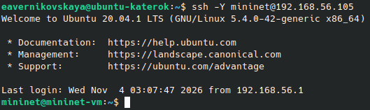{#fig-001 width=70%}

Исправили права запуска X-соединения. Скопировали значение куки (MIT magic cookie) своего пользователя mininet в файл для пользователя root ([рис. @fig-002]):

```
mininet@mininet-vm:~$ xauth list $DISPLAY
mininet@mininet-vm:~$ sudo -i
root@mininet-vm:~# xauth add mininet-vm/unix:10 MIT-MAGIC-COOKIE-1 "значение-куки"
root@mininet-vm:~# logout
```

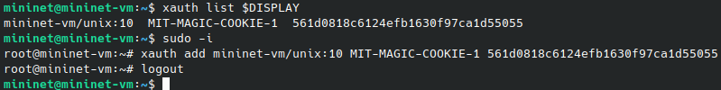{#fig-002 width=70%}

После выполнения этих действий графические приложения будут запускаться под пользователем mininet

Задали топологию сети, состоящую из двух хостов и двух коммутаторов с назначенной по умолчанию mininet сетью 10.0.0.0/8: ```sudo mn --topo=linear,2 -x```. После введения этой команды запустились терминалы двух хостов, двух коммутаторов и контроллера ([рис. @fig-003])

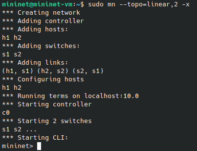{#fig-003 width=70%}

На хостах h1, h2 и на коммутаторах s1, s2 ввели команду ```ifconfig```, чтобы отобразить информацию, относящуюся к их сетевым интерфейсам и назначенным им IP-адресам. В дальнейшем при работе с NETEM и командой tc будут использоваться интерфейсы h1-eth0, h2-eth0, s1-eth2 ([рис. @fig-004])

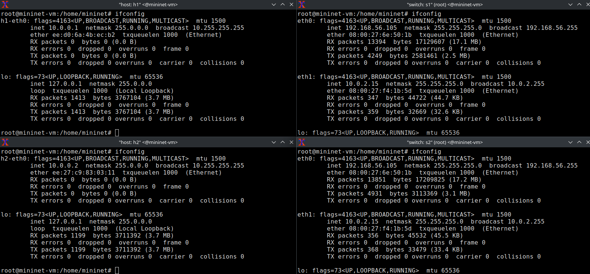{#fig-004 width=70%}

Проверили подключение между хостами h1 и h2 с помощью команды ```ping``` с параметром ```-c 4``` ([рис. @fig-005])

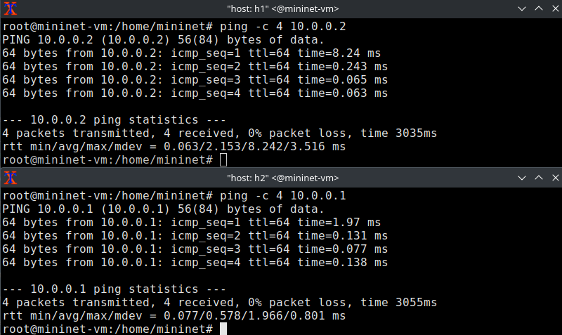{#fig-005 width=70%}

Проверили подключение с помощью инструмента iperf3 для измерения пропускной способности. Для этого:

- запустили iPerf3 в режиме сервера в терминале хоста h2 ([рис. @fig-006]): ```iperf3 -s```
- запустили iPerf3 в клиентском режиме в терминале хоста h1 ([рис. @fig-006]): ```iperf3 -c 10.0.0.2```
- для остановки сервера iPerf3 нажали ```Ctrl + c``` в терминале хоста h2

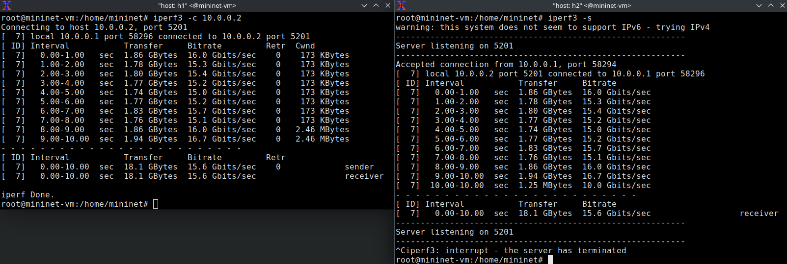{#fig-006 width=70%}

Скорость передачи данных 15-16.7 Gbits/sec

##  Интерактивные эксперименты

### Ограничение скорости на конечных хостах

Команду tc можно применить к сетевому интерфейсу устройства для формирования исходящего трафика. Требуется ограничить скорость отправки данных с конечного хоста с помощью фильтра Token Bucket Filter (tbf)

Изменили пропускную способность хоста h1, установив пропускную способность на 10 Гбит/с на интерфейсе h1-eth0 и параметры TBF-фильтра: ```sudo tc qdisc add dev h1-eth0 root tbf rate 10gbit burst 5000000 limit 15000000``` ([рис. @fig-007])

Здесь:

- ```sudo```: включить выполнение команды с более высокими привилегиями безопасности;
- ```tc```: вызвать управление трафиком Linux;
- ```qdisc```: изменить дисциплину очередей сетевого планировщика;
- ```add``` (добавить): создать новое правило;
- ```dev h1-eth0 root```: интерфейс, на котором будет применяться правило;
- ```tbf```: использовать алгоритм Token Bucket Filter;
- ```rate```: указать скорость передачи (10 Гбит/с);
- ```burst```: количество байтов, которое может поместиться в корзину (5 000 000);
- ```limit```: размер очереди в байтах (15 000 000)

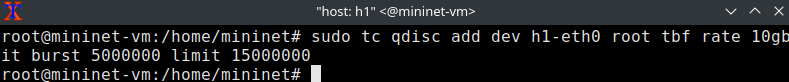{#fig-007 width=70%}

Фильтр tbf требует установки значения всплеска при ограничении скорости. Это значение должно быть достаточно высоким, чтобы обеспечить установленную скорость. Она должна быть не ниже указанной частоты, делённой на HZ, где HZ - тактовая частота, настроенная как параметр ядра, и может быть
извлечена с помощью команды ```egrep '^CONFIG_HZ_[0-9]+' /boot/config-$(uname -r)``` ([рис. @fig-008])

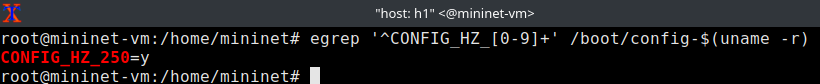{#fig-008 width=70%}

Для расчёта значения всплеска (burst) необходимо скорость передачи (10 Гбит/с или 10 Gbps = 10,000,000,000 bps) разделить на полученное таким образом значение HZ (на хосте h1 HZ = 250):
Burst = 10,000,000,000/250 = 40,000,000 bits = 40,000,000/8 bytes = 5,000,000 bytes

Проверили конфигурацию с помощью инструмента iperf3 для измерения пропускной способности. Для этого:

- запустили iPerf3 в режиме сервера в терминале хоста h2 ([рис. @fig-009]): ```iperf3 -s```
- запустили iPerf3 в клиентском режиме в терминале хоста h1 ([рис. @fig-009]): ```iperf3 -c 10.0.0.2```
- для остановки сервера iPerf3 нажали ```Ctrl + c``` в терминале хоста h2

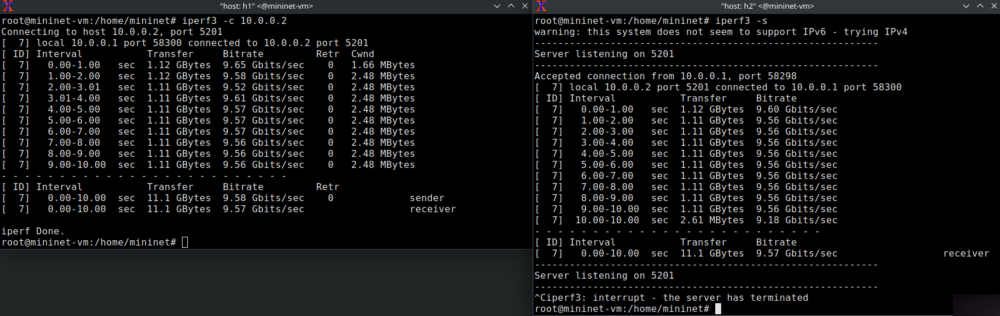{#fig-009 width=70%}

Скорость передачи данных 9.52-9.65 Gbits/sec

Удалили модифицированную конфигурацию на хосте h1: ```sudo tc qdisc del dev h1-eth0 root``` ([рис. @fig-010])

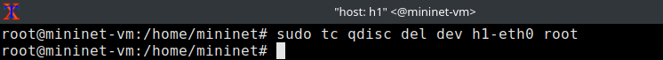{#fig-010 width=70%}

### Ограничение скорости на коммутаторах

При ограничении скорости на интерфейсе s1-eth2 коммутатора s1 все сеансы связи между коммутатором s1 и коммутатором s2 будут фильтроваться в соответствии с применяемыми правилами

Применили правило ограничения скорости tbf с параметрами rate = 10gbit, burst = 5,000,000, limit= 15,000,000 к интерфейсу s1-eth2 коммутатора s1, который соединяет его с коммутатором s2 : ```sudo tc qdisc add dev s1-eth2 root tbf rate 10gbit burst 5000000 limit 15000000``` ([рис. @fig-011])

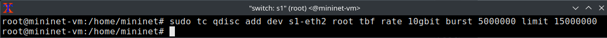{#fig-011 width=70%}

Проверили конфигурацию с помощью инструмента iperf3 для измерения пропускной способности. Для этого:

- запустили iPerf3 в режиме сервера в терминале хоста h2 ([рис. @fig-012]): ```iperf3 -s```
- запустили iPerf3 в клиентском режиме в терминале хоста h1 ([рис. @fig-012]): ```iperf3 -c 10.0.0.2```
- для остановки сервера iPerf3 нажали ```Ctrl + c``` в терминале хоста h2

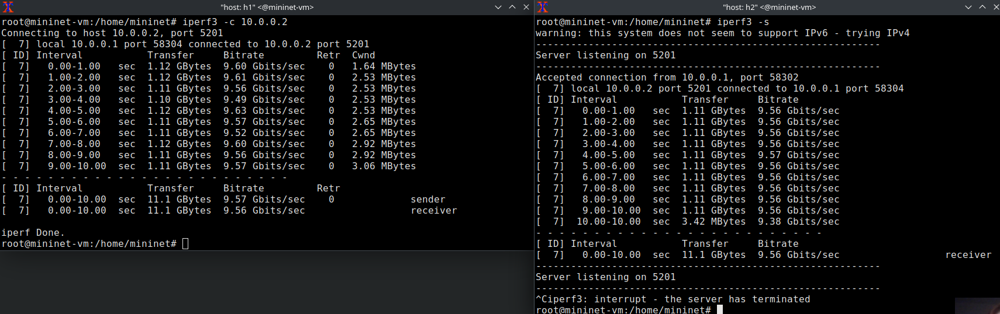{#fig-012 width=70%}

Скорость передачи данных 9.49-9.63 Gbits/sec

Удалили модифицированную конфигурацию на коммутаторе s1: ```sudo tc qdisc del dev s1-eth2 root``` ([рис. @fig-013])

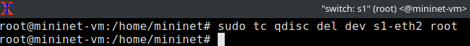{#fig-013 width=70%}

### Объединение NETEM и TBF

NETEM используется для изменения задержки, джиттера, повреждения пакетов и т.д. TBF может использоваться для ограничения скорости. Утилита tc позволяет комбинировать несколько модулей. При этом первая дисциплина очереди (qdisc1) присоединяется к корневой метке, последующие дисциплины очереди можно прикрепить к своим родителям, указав правильную метку

Объединили NETEM и TBF, введя на интерфейсе s1-eth2 коммутатора s1 задержку, джиттер, повреждение пакетов и указав скорость: ```sudo tc qdisc add dev s1-eth2 root handle 1: netem delay 10ms``` ([рис. @fig-014])

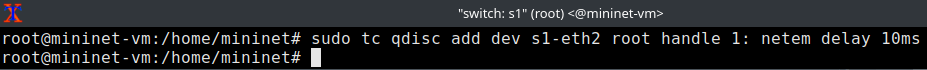{#fig-014 width=70%}

Здесь ключевое слово ```handl```e задаёт дескриптор подключения, имеющий смысл очерёдности подключения разных дисциплин ```qdisc```

Убедились, что соединение от хоста h1 к хосту h2 имеет заданную задержку. Для этого запустили команду ```ping``` с параметром ```-c 4``` с терминала хоста h1 ([рис. @fig-015])

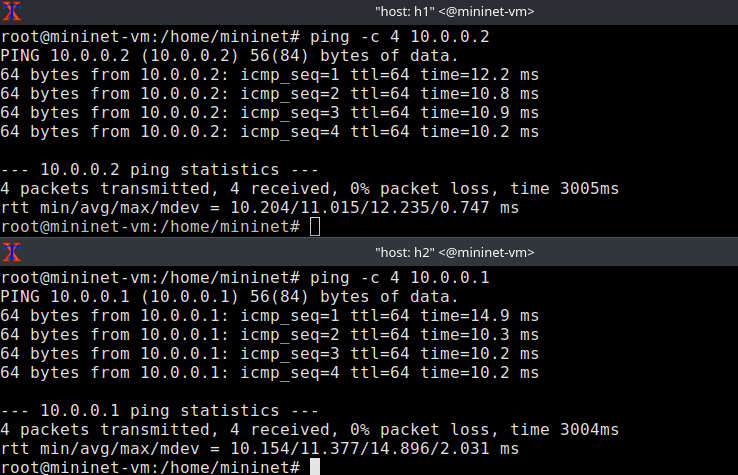{#fig-015 width=70%}

Добавили второе правило на коммутаторе s1, которое задаёт ограничение скорости с помощью tbf с параметрами rate=2gbit, burst=1,000,000, limit=2,000,000: ```sudo tc qdisc add dev s1-eth2 parent 1: handle 2: tbf rate 2gbit burst 1000000 limit 2000000``` ([рис. @fig-016])

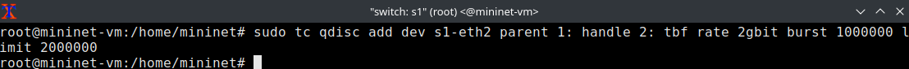{#fig-016 width=70%}

Проверили конфигурацию с помощью инструмента iperf3 для измерения пропускной способности. Для этого:

- запустили iPerf3 в режиме сервера в терминале хоста h2 ([рис. @fig-017]): ```iperf3 -s```
- запустили iPerf3 в клиентском режиме в терминале хоста h1 ([рис. @fig-017]): ```iperf3 -c 10.0.0.2```
- для остановки сервера iPerf3 нажали ```Ctrl + c``` в терминале хоста h2

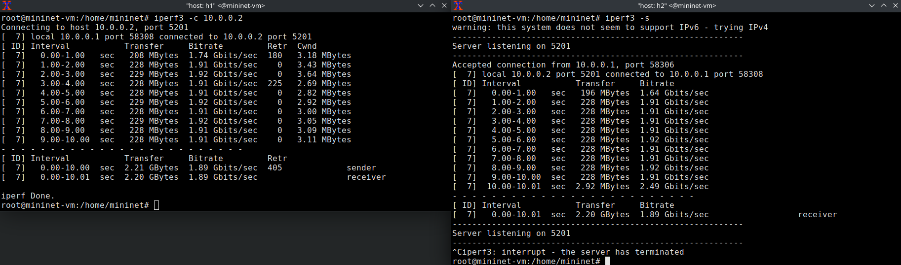{#fig-017 width=70%}

Скорость передачи данных 1.74-1.92 Gbits/sec

Удалили модифицированную конфигурацию на коммутаторе s1: ```sudo tc qdisc del dev s1-eth2 root``` ([рис. @fig-018])

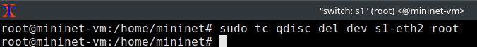{#fig-018 width=70%}

## Воспроизведение экспериментов

### Предварительная подготовка

Самостоятельно реализовали воспроизводимые эксперименты по использованию TBF для ограничения пропускной способности. Построили соответствующие графики

По аналогии с предыдущими лабораторными работами для каждого воспроизводимого эксперимента ```expname``` создали свой каталог, в котором будут размещаться файлы эксперимента ```mkdir -p ~/work/lab_tbf/expname```. Здесь ```expname``` принимает значения ```tbf-host```, ```tbf-switch``` и ```tbf-netem```. Также для каждого случая создали скрипт для проведения эксперимента ```lab_tbf.py``` ([рис. @fig-019])

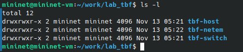{#fig-019 width=70%}

### Ограничение скорости на конечных хостах

С помощью API Mininet воспроизвели эксперимент по ограничению скорости на конечных хостах

В виртуальной среде mininet перешли в каталог ```tbf-host``` и создали скрипт для эксперимента ```lab_tbf.py``` ([рис. @fig-020]): 

```python                                                          
#!/usr/bin/env python

"""
Simple experiment.
Output: ping.dat
"""

from mininet.net import Mininet
from mininet.node import Controller
from mininet.cli import CLI
from mininet.log import setLogLevel, info
import time

def emptyNet():

    "Create an empty network and add nodes to it."

    net = Mininet( controller=Controller, waitConnected=True )

    info( '*** Adding controller\n' )
    net.addController( 'c0' )

    info( '*** Adding hosts\n' )
    h1 = net.addHost( 'h1', ip='10.0.0.1' )
    h2 = net.addHost( 'h2', ip='10.0.0.2' )

    info( '*** Adding switches\n' )
    s1 = net.addSwitch( 's1' )
    s2 = net.addSwitch( 's2' )

    info( '*** Creating links\n' )
    net.addLink( h1, s1 )
    net.addLink( s1, s2 ) 
    net.addLink( h2, s2 )

    info( '*** Starting network\n')
    net.start()

    info( '*** Set rate\n')
    h1.cmdPrint( 'sudo tc qdisc add dev h1-eth0 root tbf rate 10gbit burst 5000000 limit 15000000' )

    info( '*** Starting iperf3 server on h2\n')
    h2.cmdPrint( 'iperf3 -s &')
    info( '*** Starting iperf3 client on h1\n')
    h1.cmdPrint( 'iperf3 -c', h2.IP(), '| grep "MBytes" | awk \'{print $7}\' > ping.dat' )

    time.sleep(12) # Wait 12 seconds

    info( '*** Stopping network' )
    net.stop()

if __name__ == '__main__':
   setLogLevel( 'info' )
   emptyNet()
```

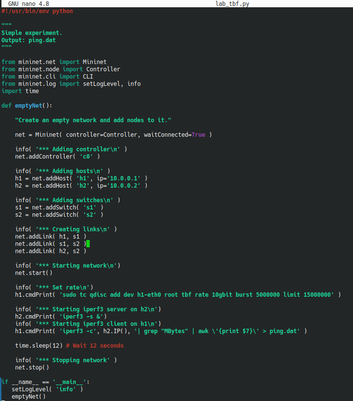{#fig-020 width=70%}

Скрипт ```lab_tbf.py``` создаёт в Mininet топологию из двух хостов (```h1``` - 10.0.0.1, ```h2``` - 10.0.0.2) и коммутаторов s1, s2, запускает сеть с контроллером ```c0``` и добавляет на интерфейс ```h1-eth0``` правило ограничения скорости до 10 Гбит/с через ```tc qdisc ... tbf rate 10gbit burst 5000000 limit 15000000```. После запуска сервера iPerf3 на ```h2``` и клиента iPerf3 на ```h1``` он ждёт 12 с, через конвейер ```grep "MBytes" | awk '{print $7}'``` извлекает из вывода значения скорости передачи и сохраняет их в файл ```ping.dat```, а в конце останавливает сеть вызовом ```net.stop()```

Создали скрипт для визуализации результатов эксперимента ```ping_plot``` ([рис. @fig-021]): 

```bash
#!/usr/bin/gnuplot --persist

set terminal png crop
set output 'ping.png'
set xlabel "Packet number"
set ylabel "Rate"
set grid
plot "ping.dat" with lines
```

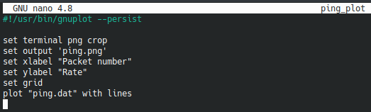{#fig-021 width=70%}

Создали ```Makefile``` для управления процессом проведения эксперимента ([рис. @fig-022]): 

```bash
all: ping.dat ping.png

ping.dat:
        sudo python lab_tbf.py
        sudo chown mininet:mininet ping.dat

ping.png: ping.dat
        ./ping_plot

clean:
        -rm -f *.dat
```

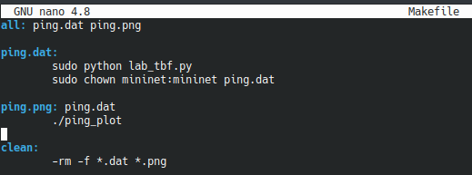{#fig-022 width=70%}

Далее выполнили эксперимент: ```make``` ([рис. @fig-023])

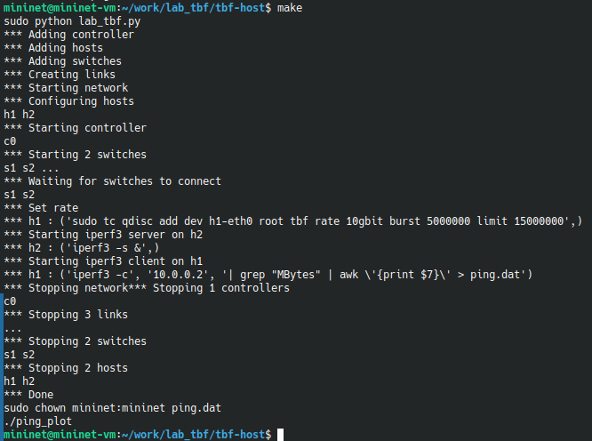{#fig-023 width=70%}

Посмотрели график построенный в результате выполнения скриптов ([рис. @fig-024])

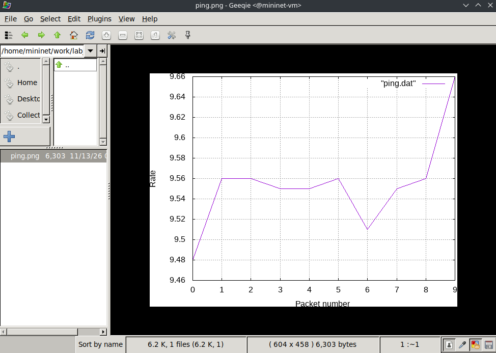{#fig-024 width=70%}  

Очистили каталог от результатов проведения экспериментов: ```make clean``` ([рис. @fig-025])

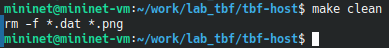{#fig-025 width=70%} 

### Ограничение скорости на коммутаторах

С помощью API Mininet воспроизвели эксперимент по ограничению скорости на коммутаторах

В виртуальной среде mininet перешли в каталог ```tbf-switch``` и отредактировали скрипт для эксперимента ```lab_tbf.py``` ([рис. @fig-026]):

```python
s1.cmdPrint( 'sudo tc qdisc add dev s1-eth2 root tbf rate 10gbit burst 5000000 limit 15000000' )
```

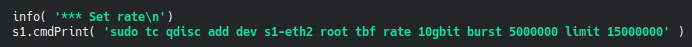{#fig-026 width=70%}

Далее выполнили эксперимент: ```make``` ([рис. @fig-027])

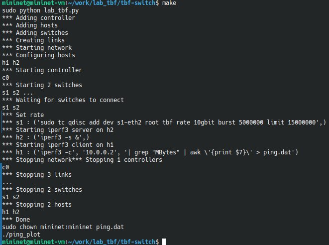{#fig-027 width=70%}

Посмотрели график построенный в результате выполнения скриптов ([рис. @fig-028])

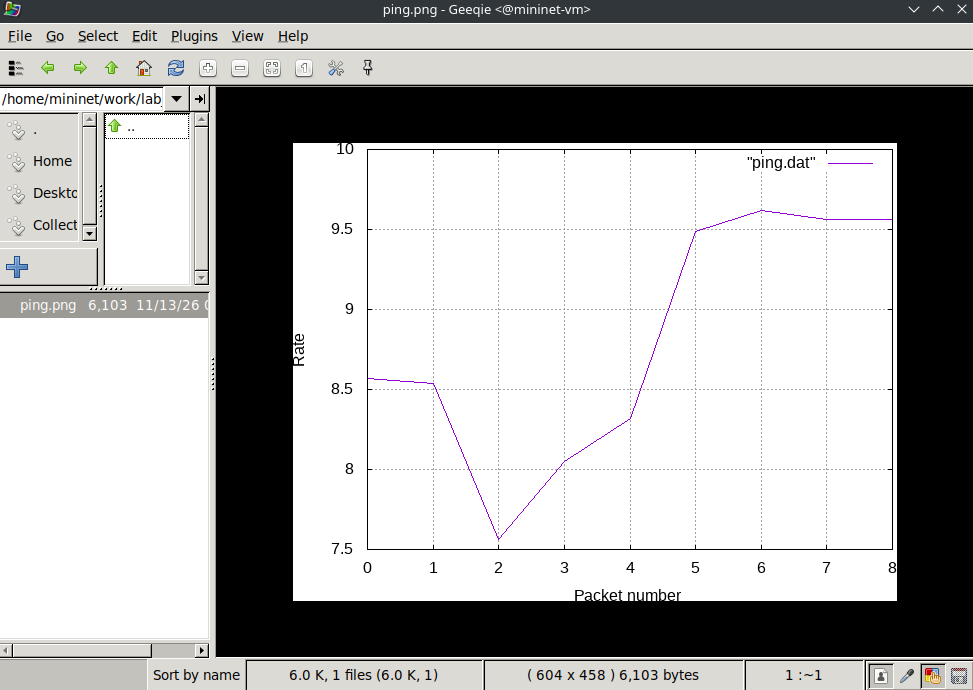{#fig-028 width=70%}   

Очистили каталог от результатов проведения экспериментов: ```make clean``` ([рис. @fig-029])

{#fig-029 width=70%} 

### Объединение NETEM и TBF

С помощью API Mininet воспроизвели эксперимент по объединению NETEM и TBF

В виртуальной среде mininet перешли в каталог ```tbf-netem``` и отредактировали скрипт для эксперимента ```lab_tbf.py``` ([рис. @fig-030]):

```python
s1.cmdPrint( 'sudo tc qdisc add dev s1-eth2 root handle 1: netem delay 10ms' )
s1.cmdPrint( 'sudo tc qdisc add dev s1-eth2 parent 1: handle 2: tbf rate 2gbit burst 1000000 limit 2000000' )
```

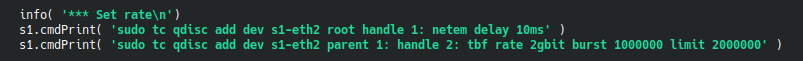{#fig-030 width=70%}

Далее выполнили эксперимент: ```make``` ([рис. @fig-031])

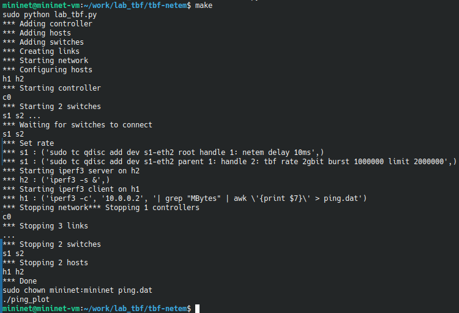{#fig-031 width=70%}

Посмотрели график построенный в результате выполнения скриптов ([рис. @fig-032])

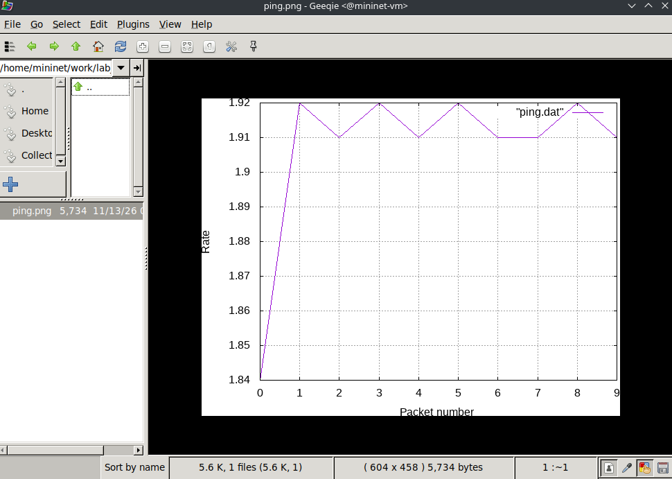{#fig-032 width=70%}  

Очистили каталог от результатов проведения экспериментов: ```make clean``` ([рис. @fig-033])

{#fig-033 width=70%} 

# Выводы

В ходе выполнения лабораторной работы №6 мы познакомились с принципами работы дисциплины очереди Token Bucket Filter, которая формирует входящий/исходящий трафик для ограничения пропускной способности, а также получили навыки моделирования и исследования поведения трафика посредством проведения интерактивного и воспроизводимого экспериментов в Mininet

# Список литературы{.unnumbered}

::: {#refs}
:::
